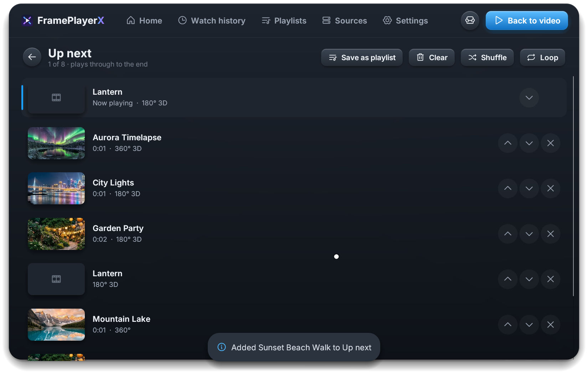

<p align="center">
  
</p>

# FramePlayerX

[](https://github.com/remotesojourner/frameplayerx/actions/workflows/ci.yml)
[](https://github.com/remotesojourner/frameplayerx/releases/latest)
[](https://github.com/remotesojourner/frameplayerx/releases)
[](LICENSE)

A VR video player for the Valve Steam Frame. It plays flat, 180°, 360° and fisheye videos, in 2D or 3D, from the headset, a microSD card, a USB drive or a media server. It runs natively on the headset and plays 8K video smoothly with the display at 120 Hz.

---

## Features

- **Video formats**: 180°, 360°, fisheye, flat and interlaced (1080i, DVD) videos, in 2D or 3D: side by side or top/bottom at full or half size, frame sequential, and 3D Blu-ray (disc images, MKV rips and `.ssif` files) in full 3D. The format is detected automatically, and you can change it for any video
- **Hardware decoding**: HEVC (H.265) in 8 and 10 bits and H.264, up to 8K, play on the Frame's own video decoder; AV1, VP9, interlaced video and anything else play with software decoding
- **Performance**: out of the box, 8K 60 fps video, 10-bit included, plays at full frame rate with the display at 120 Hz and 3744 pixels per eye, and the CPU stays almost idle: the decoder's pictures are drawn without being copied, and foveated rendering that follows your eyes keeps full detail where you look. Refresh rate, resolution and foveation can be changed in Settings, even while a video plays
- **HDR**: HDR10 and HLG videos are fitted to the Frame's screen scene by scene, and colours it can't show are toned down instead of cut off
- **Adjustments**: position, zoom, depth, picture settings and fisheye lens calibration, kept for each video or saved as presets to use on any video, and a screen that follows your head for watching lying down
- **Passthrough videos**: see your room around the people in passthrough videos, and behind green or blue screens
- **Subtitles and spatial audio**: subtitles from a file or inside the video, picked in your language and shown in any script, and 360° audio that follows your head
- **Videos on the headset**: browse any folder on the headset, a microSD card or a USB drive, including cards formatted on Windows or a Mac, and make libraries of your folders, with thumbnails, filters and sorting
- **Media servers**: browse and play from Jellyfin, Emby and Plex, which can transcode while you watch and sync watch state; any server with a DeoVR feed or HereSphere API, transcoding when it offers that and, with HereSphere, syncing watch state; and network shares (SMB), SFTP servers, WebDAV, DLNA servers and web folders
- **Watch history, Up next and playlists**: carry on where you left off, queue videos to play one after another, in order or shuffled, and loop the queue or a single video; keep playlists of videos from any source, and mark favorites and ratings
- **PIN locks**: hide a source behind a PIN until you unlock it
- **Haptic devices**: optional, off until turned on; syncs supported haptic devices with videos that have scripts
- **Phone remote**: control the player from your phone's browser, which pairs with a code the headset shows and can type into the headset too, or from apps made for DeoVR's remote
- **Custom controls**: choose what each controller button does
- **Languages**: English, German, Spanish, French, Japanese and Simplified Chinese, following the language Steam is set to; the phone remote follows the headset
- **Updates**: checks for a new version when it starts, and installs it from Settings when you choose to, on a Stable or a Beta channel
- **No FramePlayerX account or tracking**: it connects to the servers you add, to Plex's account services if you link Plex (to sign in, find your servers and renew access) and to GitHub to check for updates, and sends nothing after a crash unless you choose to send the report, which you can read first (no video names, folders or server addresses)

---

## Requirements

| Requirement | Notes |
|---|---|
| Valve Steam Frame | Developer Mode only to install with Frame Control<!-- , FrameDrop --> or a PC |
| A PC (Windows, macOS or Linux) | Optional: only to install from a PC |
| Media server | Optional: Jellyfin, Emby or Plex, a DeoVR feed or HereSphere API, a NAS share, an SFTP server, WebDAV or DLNA |

---

## Quick Start

<p align="center">
  <a href="https://github.com/remotesojourner/frameplayerx/releases/latest/download/Install-FramePlayerX.desktop"></a>
  <!-- <a href="https://framedropvr.com/install?manifest=https%3A%2F%2Fgithub.com%2Fremotesojourner%2Fframeplayerx%2Freleases%2Flatest%2Fdownload%2Fframedrop.json"></a> -->
  <a href="https://remotesojourner.github.io/frameplayerx/frame-control.html"></a>
</p>

1. **Install FramePlayerX** with one of the buttons above, or from a terminal:

   - **Desktop Mode, on the headset**: open this page in the headset's browser and press **Desktop Mode** to download the installer. Open `Install-FramePlayerX.desktop` from your Downloads folder and confirm when Desktop Mode asks whether to trust it. A terminal window opens, installs the latest release and adds FramePlayerX to your Steam library. It may ask to close Steam for a moment; the app then shows up in Gaming Mode.

   <!-- - **FrameDrop or Frame Control, from a PC**: turn on Developer Mode (Steam Settings › System › Developer Mode) and pair the headset once with [FrameDrop](https://framedropvr.com) or [Frame Control](https://github.com/saphid/steam-frame). Then press its button in your PC's browser and it installs the latest release on the headset. -->
   - **Frame Control from a PC**: turn on Developer Mode (Steam Settings › System › Developer Mode) and pair the headset once with [Frame Control](https://github.com/saphid/steam-frame). Then press its button in your PC's browser and it installs the latest release on the headset.
     > **Note:** [FrameDrop](https://framedropvr.com) currently has a bug where it has trouble downloading from GitHub, so it isn't supported yet, but should be once the bug is fixed.

   - **`frameplayerx-install`, from a PC's terminal**: turn on Developer Mode, download `frameplayerx-install` for your PC from the [release page](https://github.com/remotesojourner/frameplayerx/releases/latest), then:

     ```bash
     frameplayerx-install pair 192.168.0.68    # once, with the headset's IP address
     frameplayerx-install                      # installs the latest release
     ```

     For `pair`, open Steam Settings › Developer › Pair new host on the headset and keep it showing.

2. **Start it** from the Steam library on the headset. Browse the headset and its cards under **On this device**, and add a library of a folder, or a media server, under **Sources › Add source**.

To update later, open **Settings › Updates** and press **Download and install** when a new version is listed, then **Restart now**. To remove it again, see [Uninstall](docs/USER-GUIDE.md#uninstall) in the user guide.

---

## Documentation

| Guide | What's in it |
|---|---|
| [User guide](docs/USER-GUIDE.md) | Installing, updating and uninstalling, sources, browsing, PIN locks, video formats, display settings, controls, passthrough, haptics, remote control and troubleshooting |
| [Development](docs/DEVELOPMENT.md) | Building and testing, how the code is organised, running without a headset (Monado and the preview harness), and releasing |
| [Contributing](CONTRIBUTING.md) | What to do before opening a pull request, what it has to say and how to test it |

---

## Help translate

FramePlayerX comes in English, German, Spanish, French, Japanese and Simplified Chinese. All but English started as machine drafts, so some wording is likely to be wrong or awkward, and corrections are welcome.

- **Correct or translate** on [Codeberg Translate](https://translate.codeberg.org/projects/frameplayerx/), Codeberg's Weblate. No Git needed: sign in with a Codeberg account, pick a language and edit its messages. A note beside each message says where it shows; "Short" marks a button, chip or tab, which should stay about as long as the English. Changes come back to this repository as pull requests.
- **Report a mistake** without translating: open a [Translation problem](https://github.com/remotesojourner/frameplayerx/issues/new?template=translation.yml) issue with the language, where it shows and the wording you'd expect.
- **Add a language**: start it on Codeberg Translate, or ask in an issue. Right-to-left languages (Arabic, Hebrew) and scripts that need shaping (Thai, Hindi and other Indic scripts) can't be shown in the interface yet.

---

## Technology Stack

| Component | Technology |
|---|---|
| Language | Rust |
| VR | OpenXR, talking to the runtime directly (no Khronos loader) |
| Graphics | Vulkan through [ash](https://github.com/ash-rs/ash); the projections are drawn per pixel in a shader, straight from the decoder's buffers, and foveated through variable-rate shading guided by eye tracking |
| Interface | [egui](https://github.com/emilk/egui) panels in VR, with the [Inter](https://rsms.me/inter/) font and [Phosphor](https://phosphoricons.com/) icons; subtitle text set by [cosmic-text](https://github.com/pop-os/cosmic-text) |
| Video | [FFmpeg](https://ffmpeg.org/) 7.1 for demuxing and software decoding, the Frame's V4L2 hardware decoder (H.264, and 8- and 10-bit HEVC), [dav1d](https://code.videolan.org/videolan/dav1d) for AV1 |
| Audio | ALSA |
| Storage | SQLite (videos, watch history, adjustments), JSON settings |
| Builds | `cargo zigbuild` for Linux ARM64 against glibc 2.28 |

---

## License

FramePlayerX is licensed under the [Apache License, Version 2.0](LICENSE). It's a modified version of FramePlayer by yellkell; see [NOTICE](NOTICE). Bundled third-party libraries and fonts keep their own licences, and the controller pictures are renders of Valve's Steam Frame controller models; see [packaging/licenses](packaging/licenses/THIRD-PARTY.txt).

FramePlayerX is an independent project, not affiliated with or endorsed by Valve. Steam and Steam Frame are trademarks of Valve Corporation.

Unless you explicitly state otherwise, any contribution intentionally submitted for inclusion in FramePlayerX by you shall be licensed under the Apache License, Version 2.0, without any additional terms or conditions.

---

## Credits

FramePlayerX began as a fork of [FramePlayer](https://github.com/yellkell/frameplayer) by [yellkell](https://github.com/yellkell), who created the original player and released it as open source. Thank you, yellkell, for the work this project is built on.

### Acknowledgements

- Reading hardware-decoded frames straight from the decoder's buffers, without copying them, follows [VideoFrameVR](https://github.com/seaweeduk/VideoFrameVR)'s approach ([#122](https://github.com/remotesojourner/frameplayerx/pull/122))
- HDR tone mapping is modelled on [mpv](https://mpv.io)'s: the BT.2390 curve, fitted to each scene's measured peak
- [Frame Control](https://github.com/saphid/steam-frame) by saphid installs FramePlayerX from a PC, and FramePlayerX's install links follow its format
- The DeoVR remote API, the DeoVR feed and the HereSphere API come from those players; FramePlayerX implements them so the servers and phone apps made for them work with it
- [FFmpeg](https://ffmpeg.org) and [dav1d](https://code.videolan.org/videolan/dav1d) decode the video, and the libraries and fonts in [Technology Stack](#technology-stack) do much of the rest. FramePlayerX uses code of FFmpeg licensed under the LGPL 2.1 or later; where to download its source, and every bundled component with its licence, is in [packaging/licenses](packaging/licenses/THIRD-PARTY.txt)
- The pictures and videos in the screenshots are AI-generated

### Players that inspired FramePlayerX

Thanks to the developers of these players for showing what the Steam Frame can do. FramePlayerX is written independently, but their work spurred us on, and they're well worth a try:

- [MatineeVR](https://embedding-shapes.itch.io/matineevr) by embedding-shapes
- [VideoFrameVR](https://github.com/seaweeduk/VideoFrameVR) by seaweeduk

---

## FAQ

### Does it run on other headsets?

No. FramePlayerX is built only for the Steam Frame, so it can use the Frame's decoder, controllers and runtime directly instead of carrying everything a cross-platform player needs.

---

### Which videos play best?

HEVC (H.265) and H.264: the Frame's hardware decoder plays them smoothly up to 8K. The Frame has no hardware decoder for AV1 or 4:2:2 video, so those play on the CPU, which can fall behind at VR sizes; a pill on the control bar shows when a video plays this way. Converted once to HEVC on a PC, they play as smoothly as the rest; the [user guide](docs/USER-GUIDE.md#hardware-decoding) has the commands.

---

### Does it work with my media server or NAS?

Yes, if it offers one of these: Jellyfin (sign in with Quick Connect or a password), Emby (a password), Plex (sign in with a linking code or an access token), a DeoVR feed or HereSphere API, SMB, SFTP, WebDAV or DLNA. Add it under Sources › Add source.

---

### Will it be released on Steam?

Not for now. I develop FramePlayerX for myself in my free time, and I don't see the point in paying Steam's $100 fee to publish it. If donations through [GitHub Sponsors](https://github.com/sponsors/remotesojourner) ever reach that amount, I'll spend them on releasing it on Steam. I don't expect any, though: it's an app built with the help of AI to solve an immediate need of my own. Meanwhile, the installers in [Quick Start](#quick-start) add it to your Steam library like a game.

---

### Why a fork instead of contributing to FramePlayer?

FramePlayer reached Jellyfin, where most of the films I wanted to watch are, only through DLNA, and I wanted to use it directly. It also didn't support half side-by-side videos. I also had a different idea for browsing sources than its library screen, and while FramePlayer focuses on adult videos, I wanted a player for every kind of media. Together that made a different app rather than a few changes to the original.

---

### Do you plan to add new features?

If I come across a new idea or receive a suggestion that fits a VR video player for the Frame, I will consider adding it, but there are no promises: this project exists to solve my own needs first.

---

## Screenshots

| Home | Player & adjustments |
| :---: | :---: |
|  |  |
| **Video library** | **Jellyfin server** |
|  |  |
| **Local folders** | **Video details** |
|  |  |
| **Up next queue** | **Controller settings** |
|  |  |

---

## A Note on AI

This project was built with extensive help from [Claude Code](https://claude.com/claude-code).
